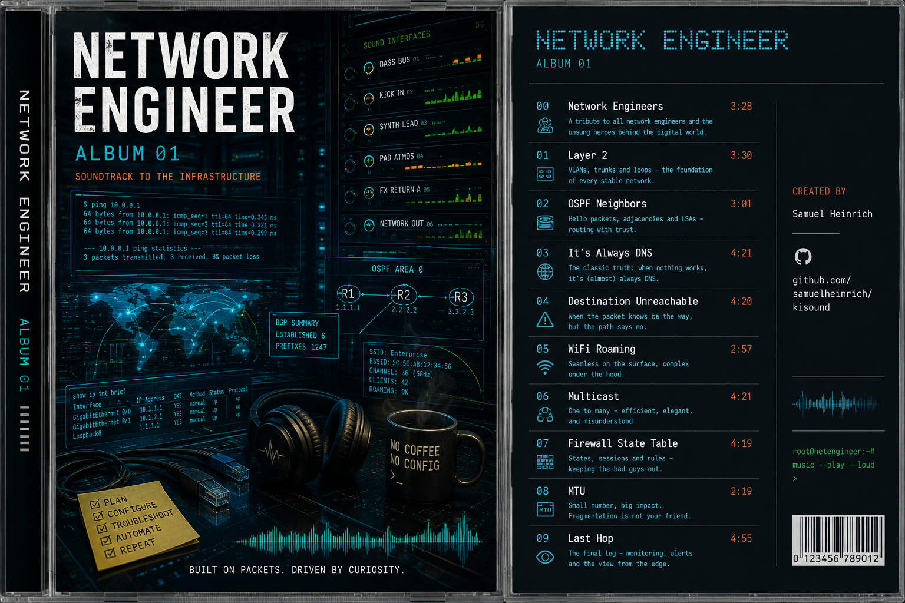
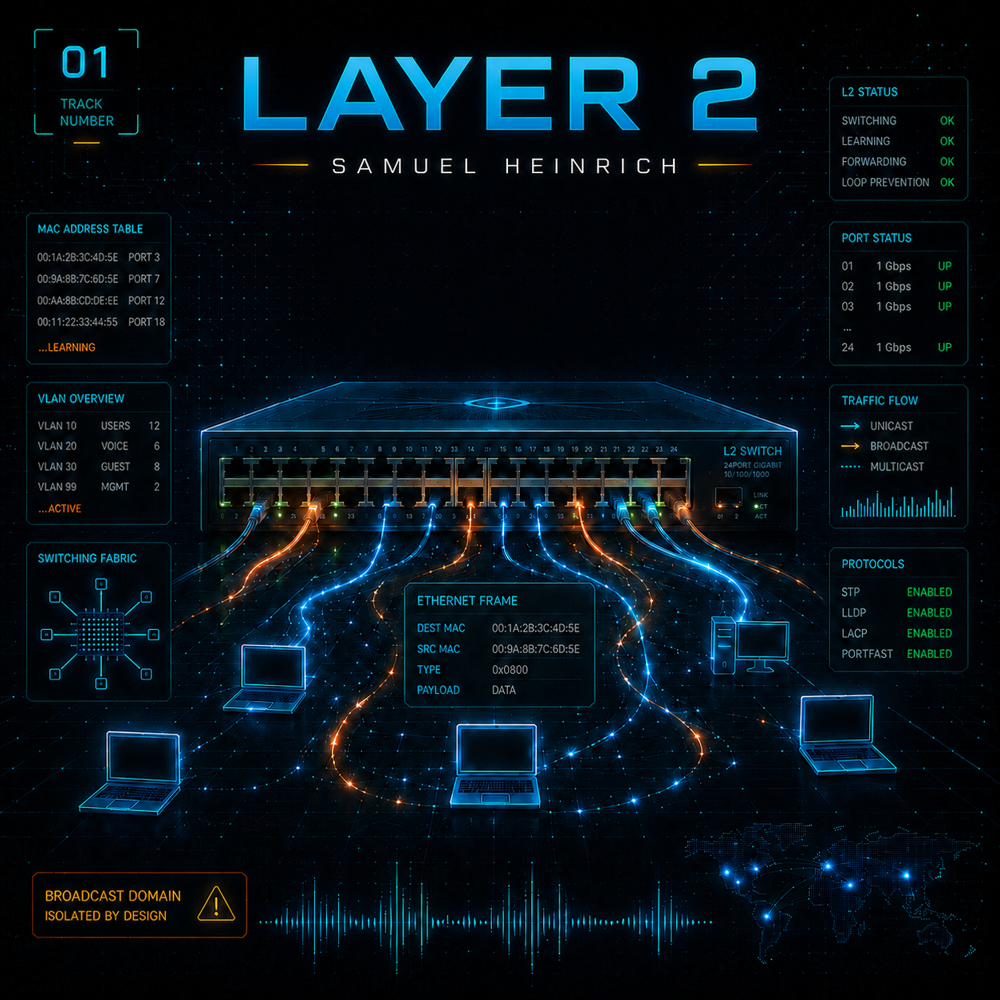
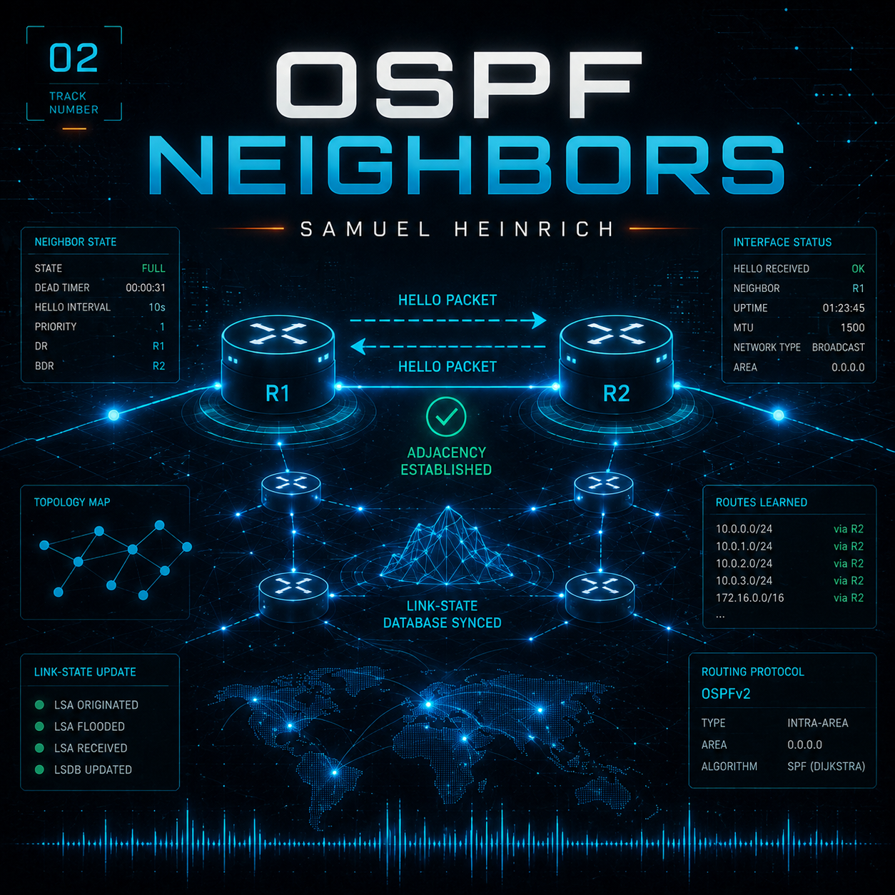
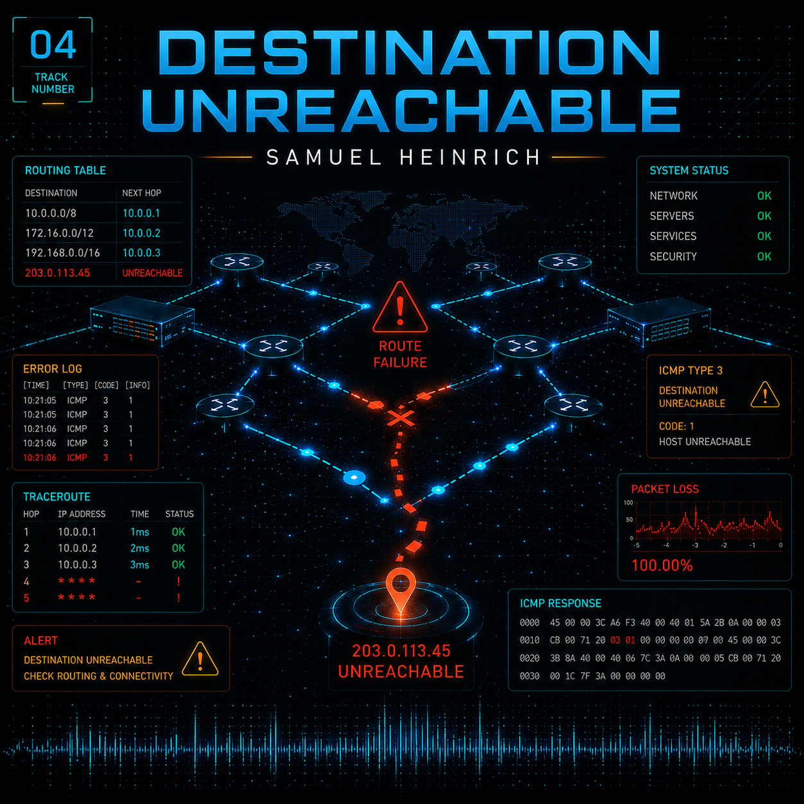
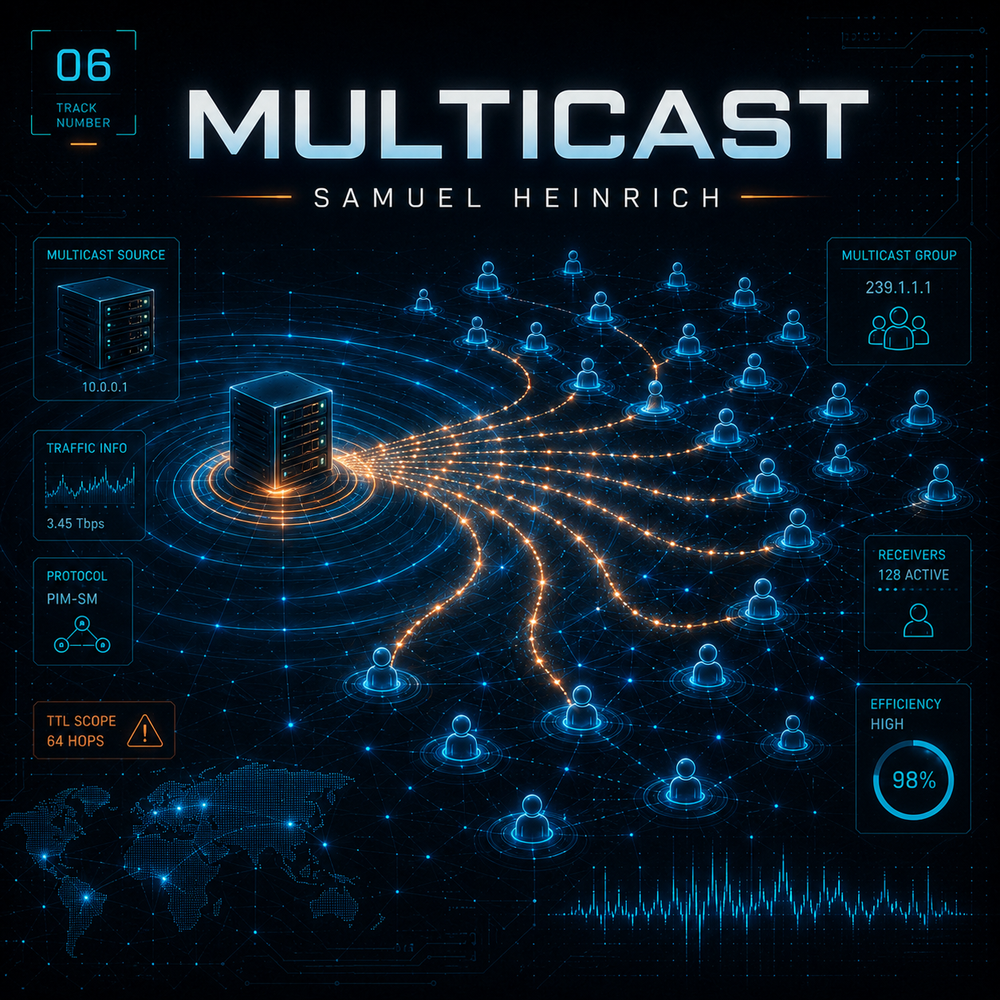
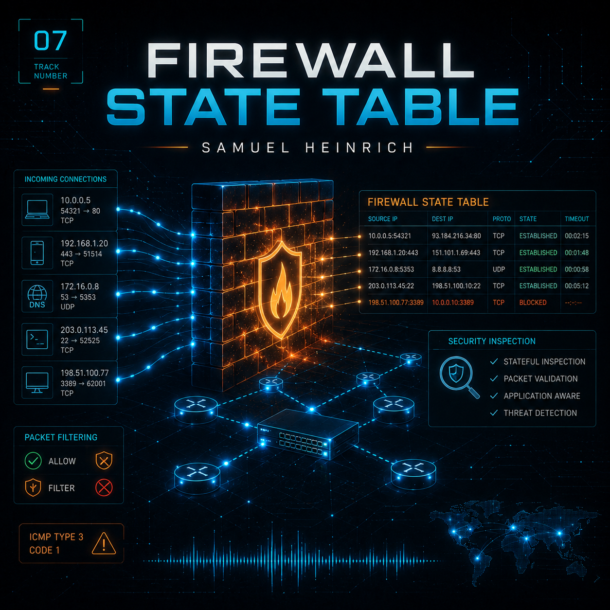
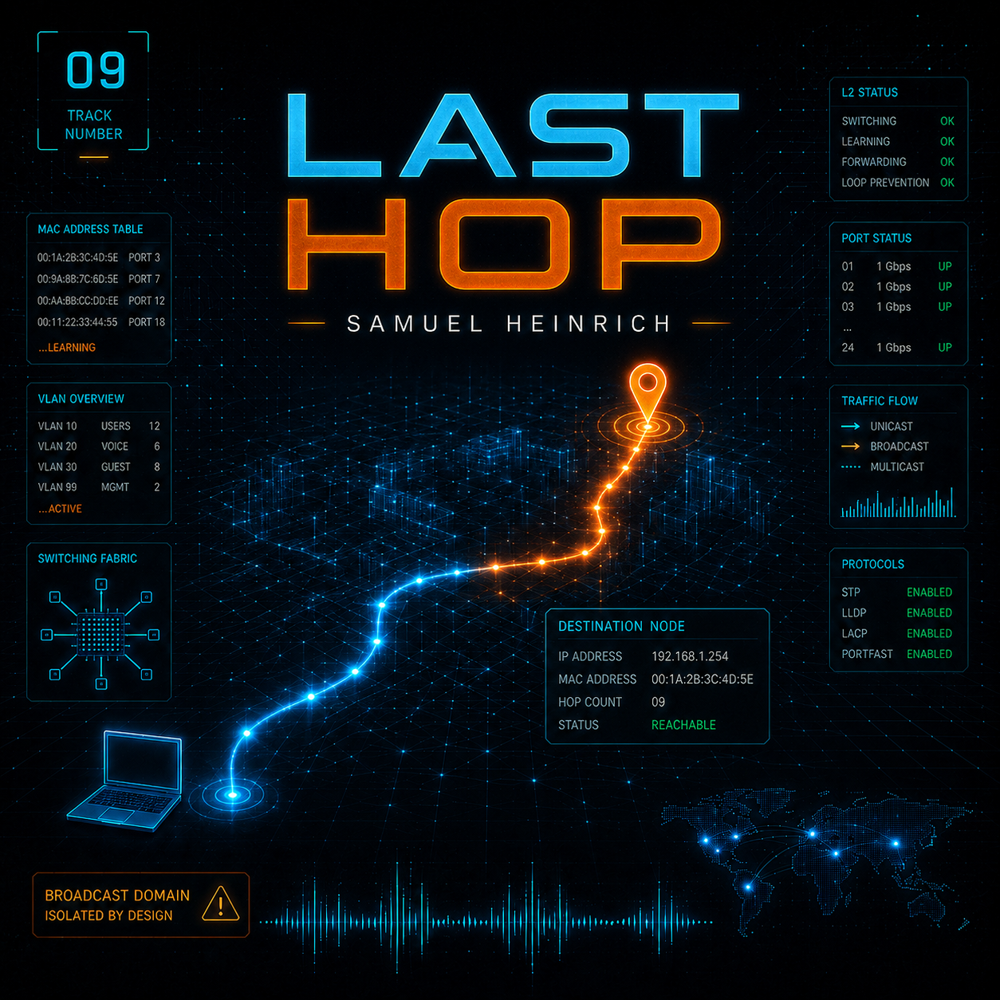

# Network Engineer Album

Electronic album about network engineering, IT infrastructure, WiFi, routing, security and packet-level troubleshooting. The base sound is electronic music with strong bass, but each track uses a different substyle.

## Album Cover

## Final Release Tracks

| # | Cover | Track Title | Duration | Release WAV | Theme | Style |
|---|---|---|---|---|---|---|
| 00 |  | Network Engineers | 3:28 | `00_Network_Engineers/00_Network_Engineers_0.4-1.wav` | Network engineers as the invisible operators behind cloud, WiFi, apps, routing and uptime. | Cinematic industrial-electro intro with heavy sub-bass, slow build and serious spoken vocals. |
| 01 |  | Layer 2 | 3:30 | `01_Layer_2/01_Layer_2_0.3-1.wav` | Switching between Layer 1 and Layer 3: MAC tables, V-LANs, trunks, STP and loop prevention. | Hard electro-techno with relay-like transients, dry bassline and half-spoken technical vocals. |
| 02 |  | OSPF Neighbors | 3:01 | `02_OSPF_Neighbors/02_OSPF_Neighbors_0.3-1.wav` | OSPF hello packets, neighbors, DR/BDR, DROTHER, LSAs, SPF and ECMP. | Uplifting/dark trance with rolling bass, supersaws, arpeggios and routing call-and-response vocals. |
| 03 |  | It's Always DNS | 4:21 | `03_Its_Always_DNS/03_Its_Always_DNS_0.3-2.wav` | DNS troubleshooting humor: resolver, cache, TTL, NXDOMAIN and the classic blame cycle. | Bouncy tech-house/electro-techno with a playful hook and funky bass-driven club energy. |
| 04 |  | Destination Unreachable | 4:20 | `04_Destination_Unreachable/04_Destination_Unreachable_0.3-1.wav` | ICMP, no reply, TTL expired, blackhole routes, traceroute and lost packets. | Dark industrial techno with cold vocoder phrases, heavy sub-bass and empty-backbone atmosphere. |
| 05 |  | WiFi Roaming | 2:57 | `05_WiFi_Roaming/05_WiFi_Roaming_0.3-1.wav` | WiFi roaming, RSSI, SNR, DFS, access points, handoff and 802.11 movement. | Drum and Bass with Reese bass, fast breaks, WiFi connect sounds, signal pings and radio noise. |
| 06 |  | Multicast | 4:21 | `06_Multicast/06_Multicast_0.1-1.wav` | Multicast groups, IGMP, membership reports, querier, PIM, RP and one-to-many delivery. | Dark progressive trance/techno hybrid with rolling bass, branching arpeggios and group-call vocals. |
| 07 |  | Firewall State Table | 4:19 | `07_Firewall_State_Table/07_Firewall_State_Table_0.4-2.wav` | Firewall sessions, ACLs, TCP, UDP, source NAT, destination NAT and deep inspection. | Goa/psytrance firewall track with hypnotic acid sequences and a chant-like Drop/Log/Block hook. |
| 08 |  | MTU | 2:19 | `08_MTU/08_MTU_0.2-2.wav` | MTU, DF bit, path MTU discovery, fragmentation, tunnel overhead and packet sizing. | Brighter UK garage/electro breaks with bouncy bass, playful vocals and ping/glitch details. |
| 09 |  | Last Hop | 4:55 | `09_Last_Hop/09_Last_Hop_0.1-1.wav` | Final hop, destination reached, clean routes, stable links and the end of the album journey. | Epic cinematic progressive trance/melodic techno closer with large builds and euphoric finale. |

## Non-Release Variants Kept

- `02_OSPF_Neighbors/02_OSPF_Neighbors_0.3-2.wav` is kept as an alternate version but is not part of the release.

## Naming Notes

- File suffixes like `_0.3-1` contain the prompt version and generated variant number.
- Version and variant numbers are not part of the public track title.
- Final prompt files use version `1.0` and point to the selected release WAV.

## License Notes

- Tad.ai commercial license PDFs are stored next to the matching generated WAV where available.
- These PDFs confirm usage rights under the Tad.ai plan, but they are not copyright registration certificates.
- They do not guarantee that the generated work is copyrightable, unique, free from third-party similarity, or accepted by distributors.
- The creator remains responsible for rights clearance, upload, publication and commercial use.
