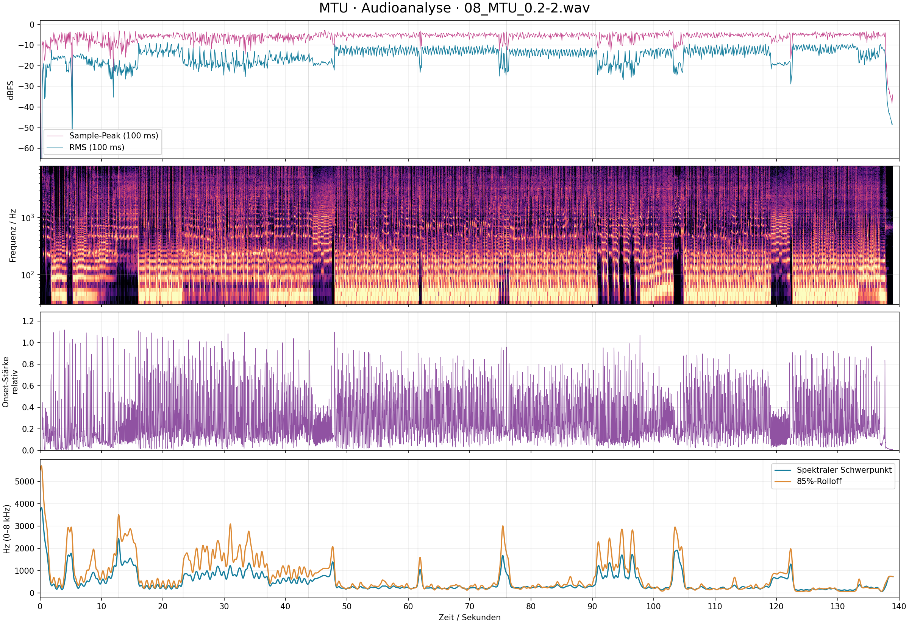

# MTU – ASTRA-AUDIO-ANALYSE

## Zweck und Datenbasis

Signaltechnische Analyse von `08_MTU_0.2-2.wav` für ein codebasiertes Musikvideo. Alle Zeitmarken beginnen beim ersten Sample der WAV-Datei. Gemessene Audioereignisse, übernommene Gesangszeiten und gestalterische Vorschläge sind getrennt gekennzeichnet.

**Hauptergebnis:** Als Arbeitsraster eignen sich **135 BPM**. Der Track ist stark bassbetont. Die instrumentale Energie setzt vor den gesungenen Chorus-Anfängen ein, besonders bei **00:48.000** und **01:44.880**. Nach dem letzten Gesang folgt nochmals ein energiereicher Abschnitt ab **02:02.640**. Erst ungefähr **02:17.800** beginnt der rasche Ausklang.

Die Analyse basiert auf Messungen, nicht auf einer behaupteten manuellen Hörprüfung. Instrumentennamen und subjektive Genrezuordnungen werden daraus nicht sicher abgeleitet.

## 1. Datei und Pegel

| Messgrösse | Ergebnis |
| --- | --- |
| PCM | 48 000 Hz, Stereo, 16 Bit |
| Samples pro Kanal | 6 672 008 |
| Exakte Dauer | 139.000166667 s |
| Dauer laut Transkript | 139.000 s; Differenz nur 8 Samples / 0.167 ms |
| Grösster Sample-Peak | -2.744 dBFS bei 00:00:46.346 |
| True Peak | ca. −2.7 dBTP, FFmpeg EBU-R128-Ausgabe auf 0.1 dB gerundet |
| RMS, gesamter Track, beide Kanäle | -13.95 dBFS |
| Globaler Crest-Faktor | 11.20 dB; Sample-Peak minus Gesamt-RMS |
| Integrierte Lautheit | −13.3 LUFS |
| Loudness Range | 3.5 LU |
| Höchste gemessene Momentary-Lautheit | −10.7 LUFS im Fenster 00:19.300–00:19.700 |
| Höchste gemessene Short-term-Lautheit | −11.4 LUFS im Fenster 02:09.500–02:12.500 |
| Samples direkt am PCM-Vollaussteuerungswert | 0 |
| Stereo-Korrelation, gesamter Track | 0.968 |

Es gibt in dieser Datei keine Samples an den digitalen Vollaussteuerungsgrenzen. Das beweist nicht die Abwesenheit früherer Bearbeitungsartefakte. Die hohe Korrelation weist auf einen stark gemeinsamen Stereoanteil hin; sie ist keine frequenzabhängige Breitenmessung. Ein einzelner Sample-Peak ist kein verlässlicher Szenenwechsel: Der grösste Wert bei 00:46.346 liegt gerade nicht am musikalisch energiereichsten Abschnitt.

## 2. Tempo, Raster und Unsicherheit

- Spektral-/Bass-Onset-Analyse: stärkster globaler Rasterkandidat **135.02 BPM**.
- Für Animationen auf **135 BPM** runden; ein Viertelpuls dauert **444.444 ms**, ein Achtelpuls **222.222 ms**, ein Sechzehntelpuls **111.111 ms**.
- **67.5 BPM** ist die plausible Halbzeit-Lesart. Ein rechnerischer Kandidat um 168.76 BPM wurde nicht als Hauptraster gewählt, weil die Autokorrelation und mehrere bassreiche Teilabschnitte das 135/67.5-Muster besser stützen.
- Das 4/4-Raster ist eine Arbeitsannahme. Es ergibt 1.777778 s pro Takt, 7.111111 s pro vier Takte und 14.222222 s pro acht Takte. Taktart und erste Zählzeit wurden nicht sicher erkannt.
- Die globale Rasterstärke ist moderat. Lokale Schätzungen schwanken unter Gesang, Pausen und wechselnden Texturen. Diese Schwankungen sind kein Nachweis tatsächlicher Tempowechsel.
- Das JSON liefert ein synthetisches Raster mit Ursprung 0.000 s. Es liegt nahe an mehreren deutlichen Einsätzen, ist aber keine vollständig annotierte Drumspur.

**Synchronisationsregel:** Für weiche zyklische Bewegung das Raster verwenden; für sichtbare Impakte die gemessenen `onsets` beziehungsweise kuratierten `events` verwenden. Gesangsaktionen bleiben an `lyrics.start_s`. Rasterpunkte nicht blind mit jedem Sprachlaut gleichsetzen und aus lokalen Schätzungen kein ständig wechselndes Animationstempo erzeugen.

## 3. Frequenzen und Oberwellen

Gemittelte spektrale Energie der Mono-Summe, normiert auf 20 Hz bis 20 kHz. Die Prozentwerte sind physikalische Energieanteile und keine wahrgenommene Lautheit oder Instrumentenlautstärke.

| Band | Bereich | Energieanteil | Geeignete visuelle Steuerung |
| --- | --- | --- | --- |
| Subbass | 20–60 Hz | 49.81 % | Grosse langsame Volumen- und Lichtpulse |
| Bass | 60–250 Hz | 36.17 % | Paketvortrieb und rhythmische Toraktivität |
| Untere Mitten | 250–500 Hz | 3.60 % | Materialdichte und Körperleuchten |
| Mitten | 500–2000 Hz | 5.87 % | Header-/Datenaktivität, sparsam dosiert |
| Präsenz | 2000–6000 Hz | 2.71 % | Konturen, kurze Detailakzente |
| Höhen | 6000–12000 Hz | 1.59 % | Feine Partikel und kurze Lichtstreifen |
| Luftbereich | 12000–20000 Hz | 0.24 % | Sehr dezentes Oberflächenglitzern |

Rund **86 %** der gemittelten Energie liegen unter 250 Hz. Die Chorus-Bereiche besitzen viel Tieftonenergie; dadurch sinkt ihr energiegewichteter Spektralschwerpunkt trotz hohen Pegels. Ein niedriger Schwerpunkt darf deshalb nicht als musikalische Ruhe fehlinterpretiert werden.

Das Langzeitspektrum besitzt einen starken, breiteren Bassbereich um **42–47 Hz**. Weitere Strukturen liegen ungefähr um **87–94, 130–140 und 172–187 Hz**. Sie passen teilweise zu Oberwellenfamilien tiefer Klänge. Die Peaks verschieben sich mit Analysefenster und Musikabschnitt; sie dürfen nicht als eine einzige exakte Grundfrequenz ausgegeben werden. Weitere deutliche Maxima im gemittelten Spektrum liegen ungefähr bei 349–369, 463 und 697 Hz.

**Grenze der Aussage:** Der fertige Mix enthält überlagerte Stimmen, Synthesizer und Transienten. Eine sichere Tonart, einzelne Instrumenten-Grundtöne oder ein THD-Verzerrungswert lassen sich aus diesen Peaks nicht seriös ableiten. Der im JSON enthaltene `harmonic_proxy` kennzeichnet zeitlich stabile spektrale Strukturen gegenüber impulsartigen Anteilen. Er ist weder ein Oberwellen-Prozentsatz noch eine Klangreinheitsmessung.

## 4. Verlauf nach Songabschnitt

Die Grenzen dieser Tabelle stammen zunächst aus dem Transkript. Die zusätzlichen Audio-Cues im folgenden Abschnitt verfeinern die Bildregie.

| Abschnitt | Beginn–Ende | RMS dBFS | Max. Sample-Peak dBFS | Schwerpunkt 0–8 kHz, Hz |
| --- | --- | --- | --- | --- |
| intro | 00:00:00.000–00:00:12.800 | -17.91 | -3.06 | 903 |
| build | 00:00:12.800–00:00:23.280 | -13.66 | -3.07 | 615 |
| verse | 00:00:23.280–00:00:37.020 | -17.43 | -3.58 | 877 |
| pre | 00:00:37.020–00:00:43.700 | -16.10 | -4.01 | 528 |
| transition | 00:00:43.700–00:00:49.340 | -15.79 | -2.74 | 646 |
| chorus | 00:00:49.340–00:01:01.580 | -12.30 | -3.49 | 243 |
| hook | 00:01:01.580–00:01:16.000 | -12.75 | -3.08 | 349 |
| verse2 | 00:01:16.000–00:01:30.520 | -13.50 | -3.46 | 292 |
| break | 00:01:30.520–00:01:45.700 | -15.37 | -2.88 | 741 |
| final | 00:01:45.700–00:01:57.800 | -12.36 | -3.58 | 225 |
| tail | 00:01:57.800–00:02:19.000 | -12.85 | -3.33 | 313 |

Der Nachklang ist im Mittel fast so energiereich wie der Final Chorus. Besonders **02:02.700–02:14.000** bleiben stark ausgeprägt. Eine lange ruhige Schlussblende ab 01:57.800 würde diese Struktur übergehen.

## 5. Zeitmarken für die Weiterverarbeitung

`Transient` bezeichnet einen schnellen spektralen beziehungsweise energetischen Anstieg. Das kann Percussion, ein Synth-Attack, ein Sprachlaut oder ein Übergang sein. Ein erkannter Spike ist nicht automatisch ein Audiofehler. Zeitmarken aus der Spektralanalyse haben ein 10-ms-Raster, aber keine garantierte Sample-Genauigkeit. Strukturmarken sind im Bereich einiger Zehntelsekunden interpretierbar.

| Zeit | Typ | Beobachtung | Verwendung im Video |
| --- | --- | --- | --- |
| 00:00:01.810 | transient | Erster deutlich ausgeprägter Anstieg | Datenkörper sichtbar beschleunigen |
| 00:00:05.250 | energy_dip | Sehr kurzer Pegelabfall; 100-ms-RMS rund −54 dBFS | Drop-Detail mit kurz erlöschender Spur |
| 00:00:05.320 | transient | Starker Wiedereintritt nach der Lücke | Neuen Sendeversuch am Sender zeigen |
| 00:00:12.800 | lyric_boundary | Ende der Intro-Zeilen laut Transkript | Zur Pfadübersicht wechseln |
| 00:00:16.010 | transient_structure | Starker Onset und anhaltender Energieanstieg | Beschleunigung durch erste funktionierende Teststrecke |
| 00:00:22.000 | structure | Übergang vom dichteren Aufbau zum luftigeren Verse-Bereich | Kamera für Header-Details beruhigen |
| 00:00:23.280 | lyric_boundary | Erster Verse beginnt laut Transkript | MTU-Messstation und 1401-B-Körper |
| 00:00:37.020 | lyric_boundary | Beginn kurzer Diagnose-Lyrics | Kleine und grosse Tests gegeneinander schneiden |
| 00:00:43.980 | transient | Markanter Impuls vor der Reduktion | Messrahmen verriegeln |
| 00:00:44.480 | structure | Spektrale Reduktion; ruhigerer Vorlauf | Engstelle isolieren, Kamerabewegung bündeln |
| 00:00:46.346 | sample_peak | Höchster einzelner Sample-Wert des Tracks | Optional ein kleines Glanzdetail; kein Pflichtschnitt |
| 00:00:48.000 | transient_structure | Starker Onset und anhaltender Bass-/Energieeinsatz | Monumentales MTU-Tor und erster grosser Anflug |
| 00:00:49.340 | lyric_boundary | M-T-U im ersten Chorus | Titelzeichen auf der Architektur aktivieren |
| 00:01:01.980 | transient_candidate | Kurzer Übergangsimpuls im Hook-Bereich | DF-Klammer als Detail betonen |
| 00:01:16.440 | structure | Kurze spektrale und Pegel-Unterbrechung | Explosionsansicht der Kapselung öffnen |
| 00:01:30.810 | structure | Beginn deutlich reduzierter, stärker unterbrochener Passage | In frontale Messhalle wechseln |
| 00:01:37.760 | transient | Starker Onset im Break | Die engste Pfadgrenze hervorheben |
| 00:01:43.320 | structure | Markante Reduktion kurz vor dem Finale | Rückmeldung erreicht Sender; Neuaufbau gross und lesbar |
| 00:01:44.880 | transient_structure | Deutlicher Wiedereintritt und Rückkehr des dichten Bassflusses | Neue passende Pakete starten |
| 00:01:45.700 | lyric_boundary | Beginn des Final Chorus | Erfolgreichen Durchtritt zeigen |
| 00:01:57.800 | lyric_boundary | Letzte transkribierte Gesangszeile endet | Datenfahrt weiterführen; noch kein Fade |
| 00:01:59.120 | structure | Deutliche Energie- und Texturreduktion | Tor in kurzer schwebender Nahaufnahme zeigen |
| 00:02:02.640 | transient_structure | Starker Wiedereintritt; danach nochmals hohe Energie | Letzte lange schnelle Durchfahrt und Netzwerk-Totale |
| 00:02:12.500 | loudness_window_end | Ende des lautesten 3-s-Loudnessfensters | Weite aktive Totale; kein stillstehendes Schlussbild |
| 00:02:13.240 | structure | Texturänderung bei weiter vorhandenem Antrieb | Kamera auf das finale MTU-Motiv ausrichten |
| 00:02:17.690 | transient | Letzter markanter Onset vor dem schnellen Ausklang | Finaler passender Datenkörper passiert den Rahmen |
| 00:02:17.800 | fade_start | Beginn des deutlich abfallenden Endpegels | Kurzen Bildfade starten |
| 00:02:19.000 | end | Tatsächliches Ende der WAV | Schwarz und Audioende |

## 6. Spikes und Transienten

Die JSON-Datei enthält alle mit dem beschriebenen Detektor erkannten Onset-Kandidaten. Die nachfolgende Auswahl zeigt starke spektrale Anstiege, nicht die höchsten Sample-Pegel. Relative Stärke ist dimensionslos und nicht zwischen unterschiedlichen Analyseverfahren vergleichbar.

| Zeitpunkt | Relative Onset-Stärke |
| --- | --- |
| 00:00:02.200 | 1.094 |
| 00:00:03.090 | 1.111 |
| 00:00:03.980 | 1.119 |
| 00:00:07.530 | 1.093 |
| 00:00:09.310 | 1.073 |
| 00:00:10.200 | 1.049 |
| 00:00:11.090 | 1.063 |
| 00:00:11.970 | 1.043 |
| 00:00:16.010 | 1.112 |
| 00:00:16.420 | 1.098 |
| 00:00:17.310 | 1.049 |
| 00:00:18.200 | 1.091 |
| 00:00:19.980 | 1.051 |
| 00:00:30.640 | 1.083 |
| 00:00:33.310 | 1.098 |
| 00:00:41.310 | 1.039 |
| 00:00:48.000 | 1.099 |
| 00:01:37.760 | 1.070 |

Für Schnittentscheidungen zuerst die kuratierte Cue-Liste verwenden. Die vollständige Transientenliste eignet sich für kleine Sekundärbewegungen. Ein kurzer Dip bei etwa 00:05.250 ist ein Gestaltungskandidat; die Messung allein erklärt nicht, ob er absichtlich produziert wurde. Es wurde keine automatische Fehlerdiagnose wie «defektes Sample» daraus abgeleitet.

## 7. Datenformat und Animation

Die Datei `ASTRA-AUDIO-ANALYSE.json` enthält:

- `source`: Dateiname und SHA-256 zur eindeutigen Zuordnung.
- `summary`: Dauer, Format, Pegel und Lautheit.
- `tempo`: BPM-Schätzung, Alternativen, Einschränkungen und synthetisches Beat-Raster.
- `events`: kuratierte Zeitmarken mit Typ, Unsicherheit und Bildvorschlag.
- `onsets`: automatisch erkannte Transienten mit Zeitpunkt und relativer Stärke.
- `lyrics`: unverändert übernommene Transkriptzeiten; keine neue automatische Sprachauswertung.
- `features_100ms`: Spaltennamen und 1390 Wertezeilen im Abstand von 100 ms; Zeitmarke jeweils Fenstermitte.
- `loudness_100ms`: Momentary- und Short-term-Lautheit, jeweils auf das Fensterende bezogen.
- `sections`, `spectrum`, `limitations`: Abschnittswerte, Spektrum und Messgrenzen.

Die sieben `*_fraction`-Spalten beschreiben Energieanteile. Die sieben `*_drive`-Spalten sind pro Band unabhängig auf dessen 95. Perzentil normierte Werte zwischen 0 und 1. Sie eignen sich besser für die sichtbare Animation von Höhen, die sonst vom Bass überdeckt würden. Bei sehr leisen Gesamtpegeln die visuellen Drives zusätzlich mit einem Pegel-Gate absenken.

Empfohlene Zuordnung:

| Datenkanal | Ziel | Verarbeitung |
| --- | --- | --- |
| `sub_20_60_drive` | Kernhelligkeit, leichtes Volumenpumpen | 25–50 ms Attack, 150–250 ms Release |
| `bass_60_250_drive` | Vortrieb, Tor-Lichtleisten | Leicht glätten; grosse Kamerafahrt weiterhin geskriptet |
| `presence_2000_6000_drive` | Konturen und Header-Aktivität | 20–40 ms Attack, 80–150 ms Release |
| `high_6000_12000_drive` | Kleine Partikelakzente | Begrenzen, kein unkontrolliertes Flackern |
| `onsets` | Impakt, Drop, mechanisches Einrasten | Kurzer Einzeltrigger; nicht jedes Ereignis hart schneiden |
| RMS | Globales Aktivitätsniveau | Etwa 200–400 ms glätten |
| `events` | Szenenwechsel | Direkte Timeline-Cues; Unsicherheit berücksichtigen |

**Wichtig für deterministisches Rendering:** Audio-Steuerkurven einschliesslich Attack/Release vorab berechnen. Kein Frame darf von der zufälligen Renderreihenfolge abhängen. Die 100-ms-Werte linear interpolieren; schnelle Impakte aus den 10-ms-Onset-Ereignissen erzeugen. Ereigniszeiten mit `round(time_s × fps)` auf den nächsten Videoframe abbilden. Audio nicht an das Beat-Raster stretchen.

Die letzten acht Samples der WAV fallen ausserhalb der vollständigen 100-ms-Analysefenster; sie bleiben im Originalaudio erhalten. Für 30 fps sind 4170 Bildframes über nominell 139 s ausreichend. Die winzige Audiodifferenz von 0.167 ms darf nicht zu einem zusätzlichen Standbild führen; beim Muxen Originalaudio erhalten und Zeitbasis bewusst behandeln.

## 8. Messmethoden und Reproduzierbarkeit

- PCM-Samples auf ±1 normiert; Sample-Peaks und RMS aus beiden Kanälen, Frequenzanalyse aus deren arithmetischem Mittel.
- FFmpeg `ebur128=peak=true`: integrierte Lautheit, LRA, Momentary, Short-term und True Peak.
- Onsets: Mono auf 16 kHz resampelt; Hann-STFT mit 2048 Samples / 128 ms Fenster und 160 Samples / 10 ms Schritt; positive log-spektrale Differenzen plus positiver Bassanstieg 35–160 Hz, Gewichtung 65/35.
- Onset-Peaks: mindestens 120 ms Abstand und mindestens 0.28 Prominenz in der intern normierten Kurve. Das ist ein pragmatischer Detektor, kein vollständiges Schlagzeugmodell.
- Tempo: Autokorrelation und periodische Rasterbewertung im Hauptteil, zusätzliche lokale Fensterkontrollen. Kein behaupteter musikalischer Downbeat-Detektor.
- Globales Spektrum: Welch-PSD bei 48 kHz mit 16384-Sample-Fenstern. Angegebene Peakstellen besitzen etwa 2.93 Hz Bin-Abstand und begrenzte musikalische Eindeutigkeit.
- 100-ms-Bandfeatures: Hann-Fenster aus 4800 Samples, auf 8192 FFT-Punkte aufgefüllt. Bin-Abstand 5.86 Hz, tatsächliche spektrale Auflösung etwa 10 Hz. Nullauffüllung verbessert keine physikalische Auflösung.
- Spektrale Stabilität: Medianfilter entlang Zeit und Frequenz als Harmonic/Percussive-Proxy, keine isolierten Stems.
- Struktur-Cues: Vergleich von Bandprofilen über ungefähr eine Sekunde links und rechts sowie Prüfung des Pegelverlaufs. Musikalische Benennung bleibt Interpretation.

## 9. Übersichtsgrafik

Die Grafik stellt vier Messansichten dar. Das Spektrogramm und die dortigen Schwerpunkt-/Rolloff-Kurven sind auf 0–8 kHz beschränkt; die JSON-Bandfeatures und globalen Bandanteile reichen bis 20 kHz. Vertikale Hilfslinien markieren die ursprünglichen Transkriptabschnitte, nicht automatisch erkannte Taktanfänge.
